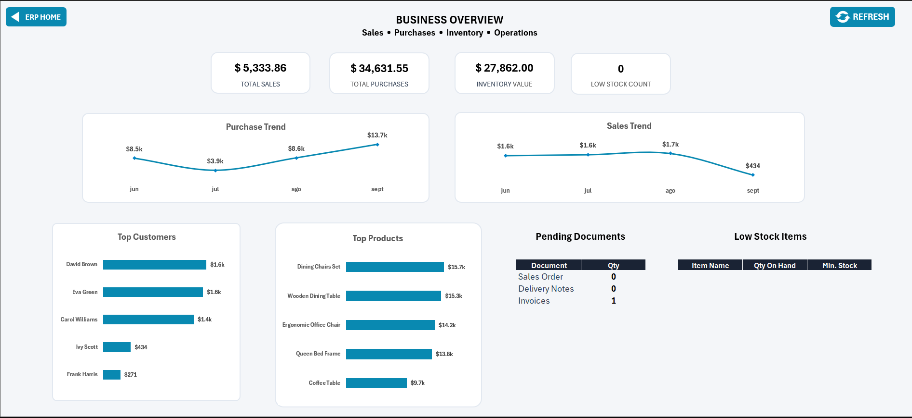
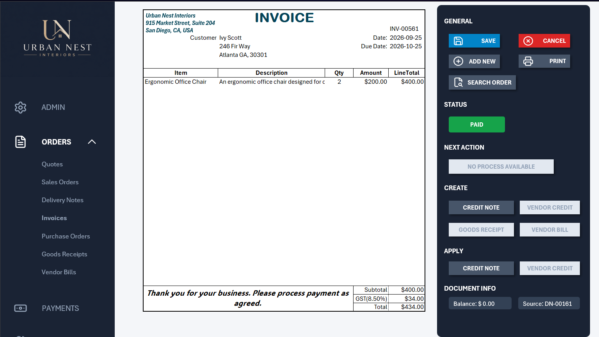

# Mini ERP System in Excel

A mini Enterprise Resource Planning (ERP) system developed in Microsoft Excel using VBA, designed to manage sales and purchasing workflows, inventory, payments, and financial document tracking.

## Project Overview

This project demonstrates how Excel VBA can be used to build an integrated business management system with linked documents, inventory movements, payment processing, balance reconciliation, and operational reporting.

The system connects business operations through document relationships and application records, providing visibility into document statuses, outstanding balances, and inventory changes.

## System Preview

The following screenshots show the dashboard and a representative invoice state from the ERP system.

## Dashboard

## Invoice - Paid

## Key Features

- **Document Management:** Create and manage sales and purchasing documents throughout their respective workflows.
- **Document Traceability:** Maintain relationships between source documents and derived documents.
- **Inventory Management:** Calculate stock levels from recorded inventory movements and classify stock conditions.
- **Payment Processing:** Record customer collections and vendor payments against outstanding documents.
- **Credit Management:** Create credit documents, validate credit availability, apply credits, and reverse applications.
- **Financial Controls:** Recalculate applied amounts, outstanding balances, and document statuses.
- **Dashboard and Reporting:** Present operational summaries using Excel PivotTables and charts.
- **Data Validation:** Apply input and business-rule validations across key workflows.

## System Modules

| Module | Description |
|---|---|
| ADMIN | Configure business details, document settings, numbering, tax rates, and categories. |
| ORDERS | Manage sales and purchasing documents, document workflows, and traceability. |
| PAYMENTS | Record customer collections and vendor payments, including payment reversals. |
| NAMES | Maintain customer, vendor, and employee records. |
| ITEMS | Manage products and services, pricing, stock thresholds, and inventory status. |
| DASHBOARD | Display operational summaries and reporting charts. |

## Demo Videos

### 1. Main Sales Workflow — SO → DN → INV → Payment

Demonstrates the end-to-end sales process, including Sales Order processing, Delivery Note creation, inventory reduction, Invoice generation, payment application, balance reconciliation, dashboard updates, and document traceability.

[Watch the Main Sales Workflow](https://youtu.be/c0g0aNYOZcw)

### 2. Payment Reversal and Credit Note Workflow

Demonstrates payment reversal, outstanding balance restoration, Credit Note creation and inventory restoration, credit application validation, application reversal, and final state verification.

[Watch the Payment Reversal & Credit Note Workflow](https://youtu.be/ZTDzejFjyL0)

*Both videos are unlisted on YouTube and can be accessed by anyone with the links.*

## Testing and Validation

The system was evaluated using nine functional test cases covering:

- End-to-end document creation and traceability.
- Payment processing and balance reconciliation.
- Inventory movements and stock restoration.
- Payment and credit application reversals.
- Credit application validation.
- Payment amount validation.

**Test results: 9 of 9 test cases passed.**

The project documentation includes the test case matrix, expected and observed results, execution status, and supporting evidence.

## Documentation

For the detailed system architecture, data model, document lifecycle, inventory rules, financial controls, testing results, and known limitations, see [`document.md`](document.md).

## Technologies Used

- Microsoft Excel
- Visual Basic for Applications (VBA)
- Excel Tables and formulas
- PivotTables and charts

## AI-Assisted Development

AI tools were used as development aids throughout the project:

- [ChatGPT](https://chatgpt.com/) — OpenAI
- [Gemini](https://gemini.google.com/) — Google
- [Qwen](https://chat.qwen.ai/) — Qwen

These tools supported code-related problem-solving, troubleshooting, and documentation. Implementation decisions and system behavior were reviewed and validated through functional testing.

## Scope and Limitations

This is a portfolio project demonstrating ERP-style workflows implemented in Excel VBA. It is not intended to replace a production ERP platform or a multi-user database-backed application.

The repository contains project documentation and demonstration links. The Excel workbook itself is not included.

## Project Background and Acknowledgments

This project began by following Randy Austin's Excel VBA training through [Excel for Freelancers](https://www.youtube.com/watch?v=QS2hEQ8aO6A&t=6702s). The training provided the foundation for the initial implementation, including the workbook structure, interface elements, tables, macros, and VBA development.

The system was subsequently redesigned and extended with additional business logic, document workflows, traceability mechanisms, inventory controls, financial validation rules, payment and credit application reversals, and functional testing.

This repository documents the resulting portfolio project, its functionality, and its test evidence. Randy Austin and Excel for Freelancers are acknowledged for the original training that informed the initial implementation.

**Original training:** [Randy Austin — Excel for Freelancers](https://www.youtube.com/watch?v=QS2hEQ8aO6A&t=6702s)

## Author

Developed as a portfolio project to demonstrate Excel VBA development, business process automation, data validation, document traceability, and inventory and financial workflow management.
